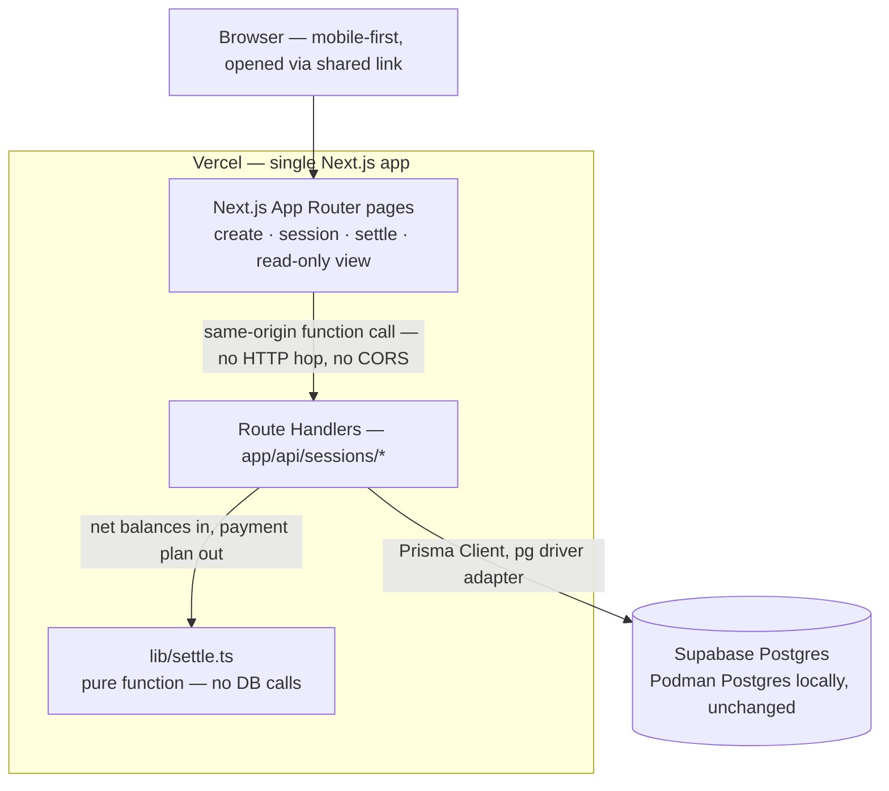
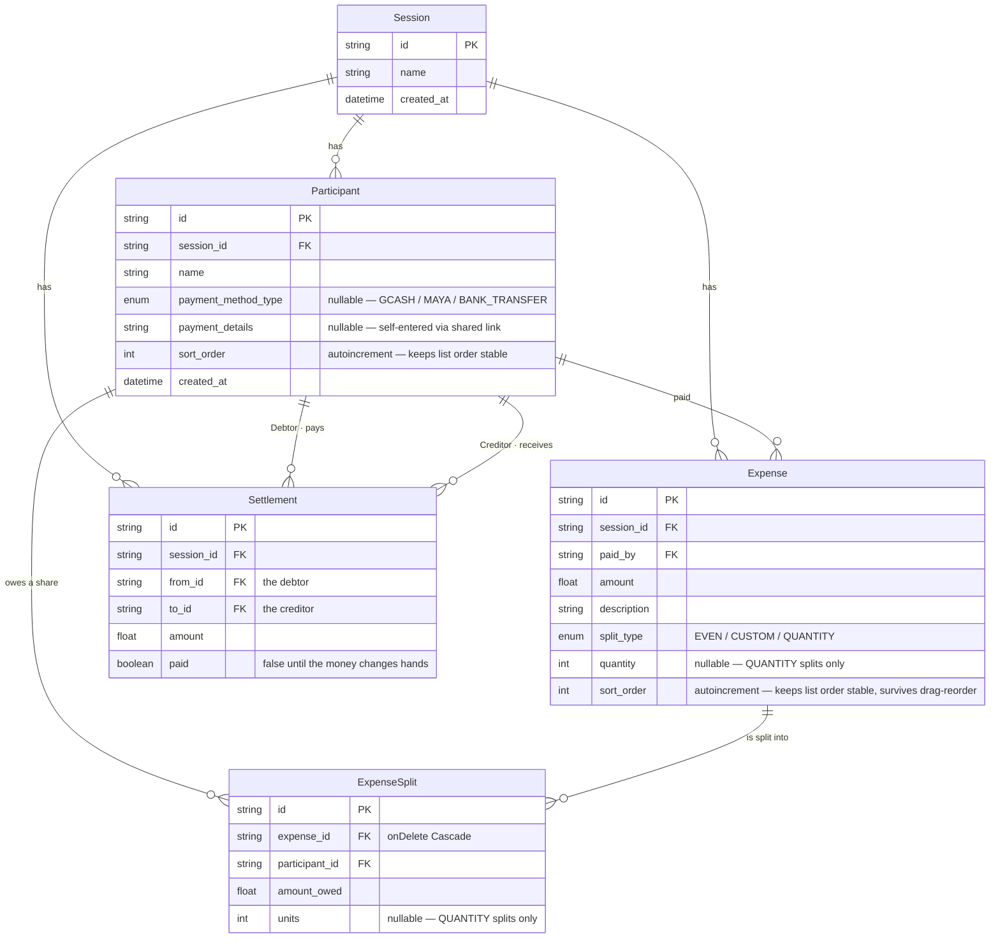

# Divvy — Architecture (current state)

A simple bill-splitting app for friend groups. See [CLAUDE.md](CLAUDE.md) for full product scope. This README documents what's actually built so far and how the pieces fit together.

## Status

| Layer                       | Status                                                  |
| ---------------------------- | --------------------------------------------------------- |
| Local Postgres (Podman)      | ✅ Running via `compose.yml`                              |
| Prisma schema                | ✅ Sessions, participants (+ payment method), expenses, splits, settlements |
| API (Next.js Route Handlers) | ✅ All V1 routes built — see table below                  |
| Settlement algorithm         | ✅ `lib/settle.ts`, greedy debt simplification             |
| Pages (Next.js App Router)   | ✅ All V1 features built — create-session, session view, settle screen, read-only `/view`, design pass. Detail under [Pages / UI](#pages--ui) |
| Deployment                   | ✅ Single Vercel project (app + API); PostgreSQL on Supabase. URLs live in their respective dashboards, not committed here |
| Git / GitHub                 | ✅ Pushed to [github.com/ryansabandal/divvy-app](https://github.com/ryansabandal/divvy-app) (private) |
| Test coverage                | ✅ Vitest — 8 unit tests on `lib/settle.ts` + 80 HTTP-level integration tests across all 11 API routes (`npm test`, `npm run test:integration`) |

> **Status:** V1 is **feature-complete, deployed, and formally closed** (2026-07-19) — a full-repo hardening pass (audit + fixes) preceded closing it. The **serverless migration** off Railway (Express + a separate Postgres) onto a single Vercel/Supabase app is also **complete** (2026-07-26). See [Roadmap](#roadmap--next-steps) for the full phase-by-phase history of both.

## High-level flow



## Local dev environment

`compose.yml` defines one service:

- **`db`** — `postgres:16`, exposed on `localhost:5432`, with a named volume (`divvy_db`) so data survives restarts.
- **The only containerized piece** — the app itself still runs directly on the host via `npm run dev`.
- **Podman, not Docker** — rootless and daemonless, per the engineering principles in CLAUDE.md.

```
podman-compose up -d     # start Postgres
podman-compose down      # stop (keeps data — add -v to wipe the volume)
```

## Architecture

Scaffolded via `create-next-app` — TypeScript, Tailwind, App Router, no `src/` dir. Single project at the repo root; there's no separate backend service and no `frontend/` subdirectory — the latter was flattened out on 2026-07-26 once the migration below made it the only app left (see [Roadmap](#roadmap--next-steps)).

- **Kept `AGENTS.md`** — it carries a warning worth knowing: Next.js 16.x has breaking changes from older training-data assumptions, e.g. `params` in `page.tsx`/`layout.tsx` is now a `Promise` that must be `await`ed, not a plain object.

```
divvy-app/
├── app/
│   ├── layout.tsx                        # root layout + sticky navy "Divvy" header (wraps all pages)
│   ├── globals.css                       # Tailwind v4 @theme tokens + hand-written component classes (btn-primary, card, input, etc.)
│   ├── page.tsx                          # create-session form (name + dynamic participant list), POSTs to /api/sessions, redirects to /{sessionId}
│   ├── [sessionId]/page.tsx              # session view — add/delete expenses (3 split modes), inline payment-method entry, share + settle buttons
│   ├── [sessionId]/settle/page.tsx       # settle screen — preview/finalize/recalculate, mark-as-paid, progress bar, copy-to-pay
│   ├── [sessionId]/view/page.tsx         # read-only participant view — expense breakdown + settlement plan, no edit controls
│   └── api/
│       ├── health/route.ts               # GET — trivial DB ping, hit weekly by the Supabase keepalive cron
│       └── sessions/                     # every route below is session-scoped; no independent top-level /api/participants or /api/expenses
│           ├── route.ts                              # POST /api/sessions
│           └── [sessionId]/
│               ├── route.ts                          # GET /api/sessions/:sessionId
│               ├── participants/route.ts              # POST participant
│               ├── participants/[participantId]/route.ts    # PATCH payment method
│               ├── expenses/route.ts                  # POST, PATCH (bulk reorder)
│               ├── expenses/[expenseId]/route.ts       # PATCH (edit), DELETE
│               ├── settlements/route.ts                # GET, POST
│               └── settlements/[settlementId]/route.ts # PATCH
├── lib/
│   ├── db.ts                             # shared Prisma client — globalThis singleton guard for dev HMR, max:1 pool behind Supabase's Supavisor pooler
│   ├── settle.ts, settle.test.ts         # debt simplification — pure function, no Prisma/DB calls
│   ├── validation.ts                     # requireValidSessionId() and friends
│   ├── requestBody.ts                    # parseBody()/parseJsonBody() — shared parse-then-validate-then-400 pipeline for every mutating route
│   ├── serialize.ts                      # DB row → API response shaping
│   ├── settlementHelpers.ts              # shared settlement-plan helpers
│   ├── expenseSplits.ts                  # split-building logic for EVEN/CUSTOM/QUANTITY
│   ├── expenseSession.ts                 # loadSessionParticipants()/validatePayer() — shared session-fetch + payer-membership check for expense routes
│   ├── recentSessions.ts                 # localStorage helper — remembers visited sessions on this device
│   ├── paymentDetails.ts                 # parseBankDetails()/formatBankDetails() — one shared home for the "Bank Name - Account Number" encoding
│   ├── fetcher.ts                        # shared SWR fetcher (generic error message parameterized per page)
│   └── expenseBreakdown.ts               # buildParticipantBreakdown() — one person's charges; pure, no React
├── components/
│   └── ExpenseBreakdown.tsx              # collapsible per-person charge list, shared by the settle + view pages
├── schemas/
│   └── sessions.ts                       # Zod schemas for every request body
├── prisma/
│   ├── schema.prisma                     # data model (Session, Participant, Expense, ExpenseSplit, Settlement)
│   └── migrations/                       # generated SQL migrations, applied to both Podman (local) and Supabase (prod)
├── prisma.config.ts                      # tells the Prisma CLI how to connect (migrate, studio, etc.)
├── tests/
│   └── sessions.integration.test.ts      # HTTP-level parity suite against a running dev server (TEST_BASE_URL)
├── vercel.json                           # pins regions: ["sin1"] to co-locate with Supabase's ap-southeast-1
├── .env                                  # DATABASE_URL for prisma.config.ts/lib/db.ts (not committed)
└── package.json
```

### Why two separate places configure the database connection

Prisma 7 removed the `url` field from `schema.prisma`, so each consumer needs its own wiring — both pointing at the same `DATABASE_URL`:

- **`prisma.config.ts`** — for the Prisma **CLI** (`prisma migrate dev`, `prisma studio`); reads `DATABASE_URL` from `.env` directly.
- **`lib/db.ts`** — for the **running app**; wraps a `pg` connection pool in a `PrismaPg` "driver adapter" and hands it to `PrismaClient`. This is Prisma 7's no-Rust-engine mode — queries go straight through the `pg` driver instead of a bundled Rust binary. A `globalThis` singleton guard prevents Next's dev-mode Hot Module Reloading from opening a fresh pool on every file save; the pool itself is pinned to `max: 1` since Supabase's Supavisor pooler (the pooled 6543 connection string used in production) already multiplexes connections across serverless instances — Prisma opening its own multi-connection pool on top of that would be redundant.

### Rate limiting (Vercel WAF)

The API is public and unauthenticated by design (no login, just a shared link), with no other bound on request volume — flagged independently by both the 2026-07-19 hardening audit and the Phase 4 post-migration security review. Rather than adding a rate-limiting dependency (`@upstash/ratelimit`, `@vercel/firewall`), this is handled entirely outside the app via two Vercel WAF custom rules (dashboard: Project → Firewall), free on Hobby (3 custom rules included, only one of which may be the `rate_limit` type).

- **Rate-limit rule — matches:** path starts with `/api/`, **any** method. An earlier version scoped this to `POST`/`PATCH`/`DELETE` only, leaving `GET /api/health` and `GET /api/sessions/:sessionId` (which returns every participant's phone number/bank account) completely unmetered — both are zero-auth, zero-knowledge-required endpoints. Broadened to cover all methods once the bypass rule below made that safe to do without breaking the integration suite.
- **Limit:** 50 requests per IP per 60s window; **action:** deny (429) for 1 minute. Closer to the original ticket's own suggested figure ("a modest cap, e.g. 100 req/min") than the first pass landed on, while still leaving headroom for Philippine CGNAT (many real users on one carrier can share a public IP) and this app's actual usage pattern — a friend group on phones hitting one session together.
- **Bypass rule — matches:** header `x-vercel-protection-bypass` equals the project's existing automation-bypass secret (the same one `tests/sessions.integration.test.ts`'s shared request helper already sends on every request, originally added to get past Preview's Deployment Protection). **Action:** bypass, ordered *before* the rate-limit rule. This decouples the numeric cap from "however many requests the test suite happens to fire" — the earlier version had to stay loose enough to survive a 182-mutating-request test run with only ~18 requests of headroom, which is what let it drift wrong (an earlier draft of this section undercounted that run at "80 requests," the test count, not the actual HTTP request count).
- **Verified:** ran `npm run test:integration` against the production URL with both rules live — 80/80 passed (all mutating requests bypassed, none counted against the 50/60s cap). A manual `curl` loop past the threshold, without the bypass header, confirmed the rule fires on all methods including `GET /api/health`.
- Not configured in code or committed anywhere else — this section is the durable record of what the rules are and why, since a dashboard-only setting is otherwise invisible to the repo.

### Data model

Defined in `prisma/schema.prisma`, mirrors the model in CLAUDE.md.



**Two separate `Participant → Settlement` edges** — every settlement row points at two different participants, the debtor (`from_id`) and the creditor (`to_id`). That ambiguity is why the schema names those relations explicitly (`@relation("Debtor", ...)` / `@relation("Creditor", ...)`): with two relations between the same pair of models, Prisma can't infer which foreign key is which.

What each model is for:

- **Session** — a bill-splitting group; has many participants, expenses, settlements.
- **Participant** — a person in a session; can pay expenses, owe splits, and owe/be owed settlements.
  - `payment_method_type` + `payment_details` are **nullable** — self-entered later via the shared link, not at creation time.
  - `sort_order` (autoincrement int) keeps the list order stable. `created_at` can't: Postgres's `now()` returns the *transaction* start time, so participants created together in one nested write all tie — and later `UPDATE`s can reshuffle physical row order.
- **Expense** — one logged cost, paid by one participant, split `EVEN` / `CUSTOM` / `QUANTITY`.
- **ExpenseSplit** — one participant's share of one expense. `onDelete: Cascade` on the `Expense` relation, so deleting an expense removes its splits automatically.
- **Settlement** — a frozen, simplified payment between two participants, with a `paid` boolean.
  - Empty until the plan is finalized — `GET .../settlements` returns a live preview while no rows exist.
  - Once `POST .../settlements` freezes the plan, those rows are the source of truth and `paid` flags persist across visits.

### Request validation (`schemas/sessions.ts`)

Request bodies go through **Zod** before any Prisma call:

- **`createSessionSchema`** — `name` (non-empty string) and `participants` (array of non-empty strings, checked element by element).
  - Previously the route only checked the array was non-empty, so `["", null]` reached Prisma.
- **`createExpenseSchema`** — a discriminated union on `split_type` (`EVEN` / `CUSTOM` / `QUANTITY`), each variant with its own required fields.
  - Replaces the old `(s: any)` inline casts, which gave TypeScript no runtime safety.
  - After `safeParse` succeeds, TypeScript narrows the body by `split_type` — no casts in the route body.
- **`updateSettlementSchema`** — `{ paid: boolean }`. Added 2026-07-26 during the post-migration code review, to bring the settlement `PATCH` route onto the same `parseBody`/Zod pipeline every other mutating route already used — it had been reading `request.json()` directly, which threw an uncaught 500 instead of a clean 400 on malformed input.

DB-level checks (session existence, participant membership, split totals) stay in the route handlers — they need lookups Zod can't do.

### Error handling

Route Handlers have no Express-style centralized error middleware. Each mutating route validates its body through `parseBody()` (a clean `400` JSON response on bad input); any unexpected exception past that point falls through to Next.js's own default `500` response, which doesn't leak a stack trace in production. This replaced Express's 4-argument error handler and its `NODE_ENV`-gated message during the Phase 3 route port — confirmed there was no equivalent needed, not just an oversight, since Route Handlers have no central catch-all to begin with.

### API routes (`app/api/sessions/**`)

| Route | Status | Notes |
| --- | --- | --- |
| `POST /api/sessions` | ✅ | Creates a `Session` and all initial `Participant` rows in one Prisma nested write; validated via `createSessionSchema` |
| `GET /api/sessions/:sessionId` | ✅ | Returns the session with `participants` and `expenses` (with `payer` + `splits`) included |
| `POST /api/sessions/:sessionId/participants` | ✅ | Adds one participant to an existing session; 404s if the session doesn't exist |
| `PATCH /api/sessions/:sessionId/participants/:participantId` | ✅ | A participant sets their own `payment_method_type` + `payment_details` |
| `POST /api/sessions/:sessionId/expenses` | ✅ | EVEN / CUSTOM / QUANTITY split; validated via `createExpenseSchema`. EVEN rounding: per-cent rounding is reconciled by pushing the ±1¢ remainder onto the first participant's share, same as QUANTITY — without this, 3-way splits of ₱100 produce ₱99.99 total and settlements never net to zero |
| `PATCH /api/sessions/:sessionId/expenses/:expenseId` | ✅ | Edits an expense in place — same validation as `POST` via `createExpenseSchema` and the shared `buildExpenseSplits()` helper, then replaces the old `ExpenseSplit` rows transactionally (`deleteMany` + nested `create`, same shape the settlement "recalculate" flow already used). Added 2026-07-19 to replace the old delete-and-recreate-to-fix-a-mistake workflow |
| `PATCH /api/sessions/:sessionId/expenses` | ✅ | Bulk reorder: caller sends every expense id in this session in its new order; `sort_order` is reassigned to match. Rejects a partial, duplicate, or foreign-id list — the array must cover every expense in the session exactly once. Deliberately a collection-level route (not nested under `/:expenseId`) so its path can never collide with the edit route above. Returns `204` with no body |
| `DELETE /api/sessions/:sessionId/expenses/:expenseId` | ✅ | Removes an expense and its splits (cascade); scoped to the session so you can't delete another session's expense by id |
| `GET /api/sessions/:sessionId/settlements` | ✅ | Returns the frozen plan (with `paid` flags) if one exists, else a live unsaved preview computed via `settle.ts`'s greedy matching; response includes names, not just ids. Also returns a `stale` boolean — for a frozen plan, it recomputes the live plan and flags a mismatch so the UI can warn that expenses changed after finalizing |
| `POST /api/sessions/:sessionId/settlements` | ✅ | Finalizes (freezes) the current preview into persisted `Settlement` rows, each starting `paid: false`. Calling it again — "Recalculate" in the UI — replaces the plan with a fresh one computed from current expenses, resetting any paid progress |
| `PATCH /api/sessions/:sessionId/settlements/:settlementId` | ✅ | Toggles one frozen payment's `paid` flag; 404s if the settlement isn't part of this session. Validated via `updateSettlementSchema` |

- **One route tree, session-scoped throughout** — every route lives under `app/api/sessions/**`; there's no independent top-level `/api/participants` or `/api/expenses`.
- **Param is `:sessionId`, not `:id`** — stays unambiguous once a route has multiple ids in scope (e.g. `participantId`).
- **Malformed ids 404 cleanly** — `requireValidSessionId()` validates UUID shape at the top of every handler with a `:sessionId` segment before any Prisma call runs. Previously (under Express) a non-UUID reached Postgres as a raw "invalid input syntax" error and surfaced as a 500.
- **Response serialization (fixed 2026-07-19)** — every route shapes its response through a `serialize*` function (`serializeParticipant`, `serializeExpenseSplit`, `serializeExpense`, `serializeSettlement`) instead of returning raw Prisma rows.
  - **Was leaking** — `sort_order`, `created_at`, `session_id`, and the raw `paid_by` id (superseded by the nested `payer` object).
  - Checked against the frontend's own TypeScript interfaces before dropping anything.
- **`buildExpenseSplits()` helper (added 2026-07-19)** — the duplicate-id guards, rounding, and remainder-distribution logic for all three split types was extracted out of `POST .../expenses` into its own function, shared with the edit route above. Written this way from the start rather than after the fact — copying that ~110-line block a second time into `PATCH .../expenses/:expenseId` would have added a third copy of logic the hardening pass already flagged as duplicated once (backlog ticket 05).

### Settlement algorithm (`lib/settle.ts`)

`computeSettlements(balances)` — takes `{ participantId, balance }[]` (positive = owed money, negative = owes money), returns the minimized `{ from_id, to_id, amount }[]`.

- **Method** — greedy debt simplification: sort creditors and debtors by size, repeatedly match the largest of each until both lists are empty.
- **Pure by design** — no Prisma or DB calls. The settlements routes do the I/O (fetch expenses, compute net balances via a shared helper), then hand the result here.
- **Why that matters** — the algorithm is independently testable; see `settle.test.ts` (8 tests).

**Reconciliation tolerance** — `RECONCILED_EPSILON = 0.005` (half a centavo), exported from `settle.ts`, reused by the CUSTOM-split guard.

- **Was** `0.01` (a full cent), intended to absorb floating-point noise.
- **Bug (found + fixed 2026-07-19)** — a full cent is *also* big enough to misclassify a genuine 1-centavo balance as already settled, silently dropping it from the plan.
- **Failure case from the audit** — someone paid ₱0.02, split ₱0.01 between two others; both were filtered out as "settled" and the payer was never reimbursed.
- **Why half a centavo** — still absorbs real float noise (~1e-13, from repeated arithmetic on already-rounded amounts), too small to ever touch a genuine cent-scale balance.
- Both failure scenarios are now regression tests in `settle.test.ts`.

**CUSTOM-split guard** — tightened the same day, reusing the same constant.

- **Was** — accepted hand-entered splits off by up to a full cent from the expense total, stored as-is.
- **Now** — rejects anything past half a centavo.
- **Why reject rather than absorb** — EVEN/QUANTITY amounts are computed by the *system*, so it owns the rounding. CUSTOM amounts are typed by a *user*, so a real mismatch should come back as an error for them to fix.

### Finalize / recalculate / mark-as-paid


- **Preview** — recomputed on every `GET` from current expenses, never persisted.
- **Finalize** (`POST .../settlements`) — freezes the preview into real `Settlement` rows so individual payments can be checked off (`PATCH`) as people actually pay each other back. This is what makes the progress bar meaningful, rather than just a snapshot of the math.
- **Expenses stay editable** at all times, even after finalizing — there's no lock.
- **Recalculate** — the same `POST` endpoint; replaces the frozen rows with a fresh plan, resetting every payment to unpaid.
- **Stale-plan warning** — a frozen plan can silently drift once expenses change. `GET` recomputes the live plan and compares it to the frozen rows (`settlementPlansMatch`, matching on payer/payee/amount). On mismatch the response sets `stale: true` and both the settle screen and the read-only view show an amber banner — settle prompts "Recalculate", the read-only view says to ask the organiser.
  - Replaces the earlier failure mode: an out-of-date total (e.g. finalized before the last expense was added) displayed with no indication it was stale.

**Rejected design** — a `Session.finalized` flag blocking adds/deletes until "unfinalized". In a no-login shared-link app, a session-wide lock any participant can toggle — which also wipes everyone else's paid progress as a side effect of fixing one missed expense — is worse UX than trusting people to recalculate.

### Inspecting the database directly

- **Prisma Studio** — `npx prisma studio` opens a browser GUI at `localhost:5555` showing every table, using the same `DATABASE_URL` as `prisma.config.ts`.
- **Raw SQL** — `podman exec -it divvy-app_db_1 psql -U divvy`, then `\dt` to list tables or `SELECT * FROM "Participant";` to query directly.

### Scripts (`package.json`)

| Script | Purpose |
| --- | --- |
| `npm run dev` | Run the app with hot reload (Turbopack) |
| `npm run build` | `prisma generate` then `next build` — Vercel caches `node_modules`, so `prisma generate` is re-run here rather than relying on `postinstall` alone |
| `npm start` | Run the production build |
| `npm run lint` | ESLint |
| `npm run prisma:migrate` | Create/apply a new migration locally (Podman Postgres) |
| `npm run prisma:deploy` | Apply existing migrations without prompting — for production, run by hand against Supabase's **direct** (5432) connection string, never in the Vercel build |
| `npm run prisma:generate` | Regenerate the Prisma Client after schema changes (also runs automatically via `postinstall`) |
| `npm test` | Run the Vitest unit suite once (`lib/settle.test.ts`) |
| `npm run test:watch` | Run the unit suite in watch mode |
| `npm run test:integration` | Run the 80-test HTTP integration suite against a running dev server (`TEST_BASE_URL`, defaults to `:3000`) |

## Pages / UI

**Data fetching** — **SWR** (`useSWR`) for client-side GETs, not `useEffect` + `useState`.

- **Why** — satisfies the `react-hooks/set-state-in-effect` lint rule, which discourages fetch-in-effect.
- `mutate()` refetches after mutations; form defaults are derived at render (no `setState` in an effect).
- **Shared helper** — `lib/fetcher.ts` (takes a per-page fallback error message as a parameter, since page wording differed slightly), replacing three copy-pasted fetchers. Every call site fetches a same-origin relative path (`/api/sessions/...`) — the old `lib/apiUrl.ts`/`NEXT_PUBLIC_API_URL` cross-origin helper was deleted during the serverless migration once the API moved into this same Next.js app.

**Add-or-edit-expense form** — one form serves both modes; `editingExpenseId` (non-null while editing) picks which. Three split modes, posting to `POST .../expenses` (add) or `PATCH .../expenses/:expenseId` (edit):

- **Evenly** (`EVEN`) — participant checkboxes.
- **Quantity** (`QUANTITY`) — total quantity → per-person units; the API computes the amounts; "units remaining" guard.
- **Amount** (`CUSTOM`) — per-person pesos; "remaining to split" guard.
- Amount/units inputs are `type="text"` (no number spinners) and clamp so totals can't exceed the expense.
- **Edit (added 2026-07-19)** — tapping a card's pencil (`✎`) button pre-fills the form from that expense (description, amount, payer, split type, and the per-participant amounts/units/checkboxes that split type needs) and scrolls it into view. The submit button becomes "Save changes"; a "Cancel" link next to the heading resets back to add-mode without submitting.
- **Reorder (added 2026-07-19)** — each card has a drag handle (`⠿`, `@dnd-kit/core` + `@dnd-kit/sortable`); dragging reassigns `sort_order` for every expense in the session via one `PATCH .../expenses` call. The reorder is optimistic (the new order shows immediately via `mutate({...session, expenses: reordered}, {revalidate: false})`) and rolls back to the server's actual order if the `PATCH` fails.
  - **Why the classic `@dnd-kit` packages, not the newer `@dnd-kit/react`** — the newer package is still pre-1.0 (`0.5.0` at the time), so its API can still break on a minor bump; `@dnd-kit/core`/`@dnd-kit/sortable` (v6/v10) haven't shipped in 19 months, which reads as a settled, mature API rather than neglect.
  - **Why a dedicated drag handle, not the whole card** — the card also has edit and delete buttons; a shared drag surface would make a tap on either ambiguous with the start of a drag.

**CORS** — none. Pages and API are the same Next.js deployment on the same origin, so the browser's cross-origin `fetch()` restrictions never come into play. This replaced Express's explicit origin allow-list, deleted during the serverless migration.

**Payment-method entry** — inline on the session view; tapping a participant's row in "Who's splitting" expands a small form. `PATCH`es `.../participants/:participantId` on save.

- **GCash / Maya** — a single phone-number input.
- **Bank Transfer** — two inputs (bank name + account number), combined on save into `"Bank Name - Account Number"` and stored in `payment_details`.
- **On the settle screen** — only the account number is copied; the bank name shows as the label (`BPI ·`) for context.
- **No identity gating** — consistent with the rest of the app, anyone with the link can set anyone's payment method.
- **Parsing lives in one place** — `lib/paymentDetails.ts` (`parseBankDetails` / `formatBankDetails`). Until 2026-07-19 it was hand-written with a magic `+3` (the separator's length) in three places independently — exactly the duplication where one drifting copy silently corrupts bank details.

**Payment display** — the settle screen reads each row's creditor payment method via a second `useSWR` call to `GET /api/sessions/:sessionId` (shares the SWR cache, so usually instant).

- All three methods follow one pattern: a label, the copyable detail, and a "Copy" button (Clipboard API).
- **No GCash/Maya deep links** — neither app exposes a public URL that pre-fills a peer transfer, so a "Pay via GCash" button would be misleading.
- **V2 plan** — QR Ph codes, which GCash, Maya, and most banks support natively. See CLAUDE.md's "Out of Scope for V1".

**Per-person charge breakdown** — every settlement row on the settle screen and the read-only view expands (`components/ExpenseBreakdown.tsx`) to show which expenses the **debtor** is being charged for, so a participant can verify their own line items without scrolling the whole expense list.

- **It describes a person, not a payment** — and that distinction is the whole design. The settlement plan is a *simplified routing of net balances*: `computeSettlements()` receives only `{participantId, balance}` and greedily matches the largest creditor to the largest debtor, so it has no idea which expense produced which part of a balance.
- **Why per-payment attribution was rejected** — it isn't well-defined. Worked example: Alice pays ₱300 lunch (split Alice/Bob/Carol), Bob pays ₱150 snacks (split Bob/Dave). The plan is `Carol→Alice ₱100`, `Dave→Alice ₱75`, `Bob→Alice ₱25`. But **Dave and Alice never shared a single expense** — Dave's only charge is Snacks, which *Bob* paid; the algorithm rerouted it. And `Bob→Alice ₱25` has one shared item worth ₱100, because Bob is separately owed ₱75. Listing line items under either row would look like a bug.
- **What it shows instead** — the person's charges, plus (only when they also fronted an expense) the offsetting arithmetic, which is what makes an otherwise-baffling row legible: *Lunch ₱100 + Snacks ₱75 = ₱175 charged, less the ₱150 Bob paid = ₱25 net owed.*
- **Partial-coverage note** — a debtor's net can be split across several creditors. When a row's amount doesn't equal the person's net (compared with a half-centavo epsilon mirroring `RECONCILED_EPSILON`), the panel says so explicitly rather than letting the totals appear contradictory.
- **No API change was needed** — both pages already fetch `GET /api/sessions/:sessionId` (the settle page for payment methods), which returns expenses with their splits. The settle page's local `Session` interface just needed widening, typed via the breakdown module's own `BreakdownExpense` shape rather than redeclaring the full `Expense` interface a fourth time.

**Delete expense** — each expense card has a small `✕` button: confirms via `window.confirm`, fires `DELETE .../expenses/:expenseId`, refetches. Errors surface in a red banner above the list.

**Shareable read-only link** — `[sessionId]/view/page.tsx` hits the same two endpoints as the session and settle pages, rendered read-only: expense breakdown, settlement plan with payment-copy buttons, progress bar if the plan is frozen. No forms, no delete buttons, no finalize/recalculate. The session page's "Share view link" button copies `<origin>/<sessionId>/view` to clipboard.

**Design** — Tailwind v4, beige body background, sticky navy header with the "Divvy" wordmark.

- Component classes (`.btn-primary`, `.card`, `.input`) are plain CSS in `globals.css` using `var(--color-*)` custom properties — **not `@apply`**.
- **Why** — Turbopack doesn't run PostCSS plugins, so `@apply` is never processed and silently breaks the stylesheet.
- `@theme inline` (Tailwind v4 native) defines the color tokens and generates utility classes; it works under Turbopack because it's part of Tailwind's own CSS engine, not a PostCSS step.

## Version control

- **Single root-level `.gitignore`** — covers `node_modules/`, `dist/`, `.env`/`.env.*`, `.DS_Store`; the whole repo is one Node/TS project.
- **Remote** — [github.com/ryansabandal/divvy-app](https://github.com/ryansabandal/divvy-app) (private).
- **Before resuming** — run `git status` rather than trusting any "uncommitted" notes in this file; they go stale fast.

## Roadmap / next steps

V1 is feature-complete, deployed, and **formally closed** (2026-07-19). The **serverless migration** off Railway is also **complete** (2026-07-26, phases 0 through F below) — Divvy now runs as a single Vercel project against Supabase Postgres, with no monthly Railway subscription. What's left is the small open backlog under [Phase 5](#serverless-migration-complete--2026-07-26) plus the deferred V2 trio.

### Serverless migration (complete — 2026-07-26)

**Why:** eliminate the recurring Railway subscription. Installability (PWA or native iOS) was considered first and rejected for this purpose — a PWA or a native app is still just a client calling the same hosted API, so neither removes the hosting cost.

**Architecture achieved:** one Next.js app on Vercel (Route Handlers replacing Express), Supabase Postgres (chosen over Neon specifically because Supabase Storage unblocks the whole V2 trio — QR Ph, receipt OCR, proof-of-payment — currently gated on "no file-storage infra"). Local dev is unaffected: `compose.yml` Postgres under Podman, unchanged; no Supabase CLI (needs Docker, which conflicts with the Podman-only principle).

**Phases:**

0. ✅ **Done** — HTTP-level integration tests for all 11 routes (`tests/sessions.integration.test.ts`, `npm run test:integration`, 80 tests). Deliberately written against a configurable `TEST_BASE_URL` rather than `supertest`-wrapping the Express app directly, so the identical file became the parity proof once the same suite ran clean against Next.js. Two tests were intentionally marked `[current behavior, no max-length — see ticket 18]` — they pinned a gap and were *expected* to start failing once ticket 18's fix landed in Phase 3; that flip was the signal the fix worked, not a regression.
   - **Reviewed 2026-07-26** — three parallel subagents by lens (Behavioral Truth, Coverage & Parity Fitness, Suite Quality & Portability — swapped in place of the standard Correctness/Security/Best-Practice split, since a test file has no attack surface for a Security lens to check). Behavioral Truth and Suite Quality & Portability came back clean. Coverage & Parity Fitness found 6 real gaps, all closed same-day (now 16 additional tests, 64 → 80): malformed non-UUID ids for participant/expense/settlement sub-resources (mirroring the existing `sessionId` regression test), missing session-not-found coverage on 4 routes, missing response-shape/leak-guard assertions on Expense/ExpenseSplit/Settlement (previously only Session/Participant had them), an untested QUANTITY rounding-remainder case, a test pair that actually straddles the `RECONCILED_EPSILON` boundary rather than just its neighborhood, and validation coverage for the edit route independent of POST's. One minor finding (no non-string-`name` type test) was judged too low-value and skipped.
1. ✅ **Done (2026-07-26)** — **Repo restructure** — the shared library code (`prisma/`, `prisma.config.ts`, `db.ts`, `lib/settle.ts`+`settle.test.ts` — 8 unit tests, untouched — and `schemas/sessions.ts`) moved into the single Next.js app, with `git mv` preserving file history.
   - **How:** `git mv`'d the files into what was then `frontend/`, then duplicated fresh copies back into `backend/`'s original paths so the still-live Express server (and Phase 0's test suite, which pointed at it) kept working unmodified — two sources of truth for the few days until Phase 4 deleted `backend/` outright, a deliberate tradeoff over a fragile cross-boundary import.
   - **Also merged:** backend's runtime + dev deps into the frontend's `package.json` (`express`/`cors`/`ts-node-dev` deliberately excluded — Express-only, dropped in Phase 3); added a `.env` for `DATABASE_URL` (separate from the old `.env.local`'s `NEXT_PUBLIC_API_URL`); kept `typescript` at the frontend's `^5` rather than backend's `^6.0.3`.
   - **Verified:** `npx prisma generate` and `npx tsc --noEmit` both clean; `npm run test` — 8/8 passing on `lib/settle.test.ts` in its new home; `backend`'s own test suite still 8/8, confirming the duplicates didn't break the still-live app.
2. ✅ **Done (2026-07-26)** — **Supabase setup + data migration** — provisioned Supabase Postgres (region `ap-southeast-1`, Postgres 17.6) and migrated Railway's production data across via `pg_dump`/restore, rather than starting fresh — shared session links are permanent, and a 404 for someone still holding one is a real harm.
   - **Reordered 2026-07-26** — originally listed after Phase 1 (Supabase-first); swapped because Supabase account setup wasn't done yet and repo restructure had no external blockers, letting that session start immediately.
   - **How:** neither Railway nor Supabase's host has `psql`/`pg_dump` installed locally, so both the dump and restore ran via containerized Postgres client images (`podman run postgres:18 pg_dump/psql ...`) — consistent with the "containerize everything" principle rather than installing tooling on the host. Used a `postgres:18` client to match Railway's server major version (18.4); Supabase itself ran 17.6. Also had to swap Railway's private `postgres.railway.internal` host for its public proxy address (`*.proxy.rlwy.net`) — the private host only resolves inside Railway's own network.
   - **Verified:** row counts matched exactly across all 5 tables (sessions 7, participants 21, expenses 47, splits 105, settlements 8); all 8 `_prisma_migrations` rows matched Railway's; `npx prisma migrate status` against Supabase reported "Database schema is up to date!" with zero drift. Railway remained fully live and untouched — this phase only stood up a new, separate database, so it carried zero cutover risk. Both connection strings (direct + pooled) were held for Phase 4's Vercel env vars — never written to a tracked file.
3. ✅ **Done (2026-07-26)** — **Ported the 11 routes** to Next.js Route Handlers under `app/api/sessions/**` (+ a health check), with shared logic extracted to `lib/{serialize,settlementHelpers,expenseSplits,validation,requestBody,expenseSession}.ts`.
   - **Port:** Express's `router.param("sessionId", ...)` UUID gate has no Route Handler equivalent — replaced with a `requireValidSessionId()` call at the top of every handler with a `:sessionId` segment. Bare `request.json()` also lacks Express's empty-body behavior (Express: `req.body` is `undefined` on an empty POST body; Route Handlers: `request.json()` throws a `SyntaxError` → uncaught 500) — fixed via `parseJsonBody()`/`parseBody()` in `lib/requestBody.ts`.
   - **Folded in 8 of the 9 tickets** originally slated for this phase (ticket 10 was miscategorized — see disposition below): 02 needed no code change (Route Handlers have no `NODE_ENV`-conditional error-disclosure path, confirmed via `next build && next start`); 06+18 fixed by converting both participant routes to Zod (`addParticipantSchema`, `setPaymentMethodSchema` — the latter using `z.nativeEnum(PaymentMethodType)` instead of a hand-rolled `validTypes` array); 16 fixed via `lib/expenseSession.ts`'s `loadSessionParticipants()` + `validatePayer()`, replacing ~15 duplicated lines in each of expense POST/PATCH; 17+20+21 fixed via a `reorderExpensesSchema`; 19 fixed — bulk-reorder `PATCH` now returns `204` instead of an unused re-serialized expense list, matching `DELETE`'s pattern (confirmed the frontend's `handleDragEnd` only checks `res.ok` and never reads the body, so no frontend change was needed).
   - **Reviewed twice**, per the timing policy below: once after the raw port (3-lens Correctness/Security/Best-Practice — found and fixed one Correctness bug, the empty-body 500 above, plus two Best-Practice dedup nits), and again after the ticket fold-in (scoped Correctness + Best-Practice re-check — found and fixed a Correctness check-order regression the ticket-16 dedup accidentally introduced in the expense-edit route, plus two Best-Practice findings: a dead `session` field in the dedup helper's return type, and parse-then-400 boilerplate repeated across 6 routes — both resolved via a `parseBody<T>()` helper).
   - **Verified:** `tsc --noEmit` clean, `eslint` clean (2 pre-existing findings in untouched frontend pages, unrelated to this phase), Phase 0's integration suite — 80/80 passing against `next dev`, including 3 tests updated to assert the new/fixed behavior instead of the old baseline (2 participant max-length tests now expect `400`; the bulk-reorder test now expects `204` + a follow-up GET to confirm the reorder took effect server-side).
4. ✅ **Done (2026-07-26)** — **Deploy & cutover.**
   - **Code changes:** 14 `apiUrl()` call sites converted to same-origin relative fetches, `lib/apiUrl.ts`/`NEXT_PUBLIC_API_URL` deleted entirely; `lib/db.ts` gained the `globalThis` HMR guard + `max: 1` pool; `package.json` gained a `postinstall` `prisma generate` *and* a `build`-time one (Vercel caches `node_modules`, so `postinstall` alone proved unreliable on cached deploys — this was the root cause of a real Vercel build failure hit mid-migration); the integration suite `git mv`'d into `tests/`; `vercel.json` pinned `regions: ["sin1"]` to co-locate with Supabase's `ap-southeast-1`; `.gitignore` fixed after it was found silently swallowing `.env.example`/`.env.local.example`; the weekly Supabase-keepalive GitHub Actions workflow added, hitting `/api/health`.
   - **Local verification:** full run with Express never started this session — clean install, dev server, 80/80 integration tests, clean `tsc`/lint/build, manual click-through of all 4 pages across all 14 rewired call sites.
   - **Preview deploy:** pushed `develop`, discovered Vercel's Deployment Protection (SSO) was blocking the automated integration-test runner against the preview URL — worked around it via Vercel's Protection Bypass for Automation, a project-scoped secret sent as a header, wired into the test suite's one shared request helper (a no-op when the env var is unset, so it doesn't affect local or production runs).
   - **Cutover:** re-synced Railway's production data into Supabase one more time (same containerized `pg_dump`/restore flow as Phase 2, this time run by hand rather than via tooling to keep real credentials out of tool calls); rotated the Supabase DB password before it became the permanent production credential (it had briefly been pasted in plaintext mid-session); set `DATABASE_URL` on Vercel Production (pooled 6543 string) and deleted `NEXT_PUBLIC_API_URL` from every environment; fast-forward merged `develop` into `main` (no divergent commits, so no merge commit); confirmed a pre-migration session URL still loaded correctly with all data intact on production.
   - **Decommission:** deleted the entire Railway project (Express app + Postgres) — the recurring subscription this migration exists to eliminate; deleted `backend/` (`git rm -r` on 20 tracked files, plus two untracked `.gitignore`d leftovers removed by hand).
   - **Code review:** three-lens review (Security weighted / Correctness / Best-Practice) across the whole post-migration repo. Security came back clean (no Critical/High/Medium; two Low notes on validation consistency and the absence of rate limiting). Correctness found and fixed a Medium — the Supabase-keepalive cron sat exactly on the 7-day pause boundary at GitHub's most congested scheduling slot, with no margin for Actions' own scheduling delays — and a Low missing error-body guard on the create-session page. Best-Practice found nothing above a cosmetic Low: `frontend/` still sitting at the repo root as if paired with a sibling `backend/`. All three fixed same session; the naming finding was acted on rather than deferred — `frontend/` was `git mv`'d up into the repo root (history preserved per file) and Vercel's Root Directory setting cleared in lockstep, verified via a full `tsc`/lint/build/test pass and a live post-deploy `/api/health` check against Supabase.
5. ✅ **Done (2026-07-26)** — **Phase 5: post-migration backlog cleanup** — closed the last four genuinely-open tickets, working order 13 → 12 → 01 → 03: **13** (`Settlement` missing `onDelete: Cascade`) and **12** (`noUncheckedIndexedAccess`) — see the disposition table below for both. **01** (rate limiting) — two Vercel WAF custom rules (no application code): a `/api/*`, all-methods, 50 req/IP/60s rate limit, plus a bypass rule exempting requests carrying the existing automation-bypass secret so the integration suite doesn't have to share headroom with the real-world cap. See [Rate limiting (Vercel WAF)](#rate-limiting-vercel-waf) for the full shape and reasoning. **03** (shared types module) — new `lib/types.ts`, with `lib/serialize.ts`'s return types bound to it so API↔frontend drift is a compile error.
   - **Reviewed once**, after all four tickets closed (single coherent boundary, not per-ticket — see the timing policy below). Correctness found a stale request-count claim in an early rate-limit README draft (fixed, see the section above). Best-Practice found a schema comment on `Participant.session` that described the wrong delete scenario (fixed) and a `README.md` self-contradiction — this very disposition table still listing all four as open (fixed here). Security assessed the rate-limit rule's initial shape (mutating-methods-only, 200 req/60s) as leaving `GET` traffic — including a zero-auth `/api/health` and session data reads — completely unmetered, and flagged the cap as looser than the ticket's own suggested figure; both prompted the two-rule redesign above rather than shipping the first pass. Also caught: a type-name collision between `lib/settle.ts` and the new `lib/types.ts` (both had exported `Settlement`; renamed the internal one to `SettlementTransfer`), and two shared-type fields that don't apply to their POST counterparts (documented in `lib/types.ts`).
   - **Verified:** `tsc`/lint/build/unit tests clean throughout; `npm run test:integration` 80/80 against production with both WAF rules live; manual `curl` checks confirmed 429s past the threshold on both a mutating route and `GET /api/health`.

**Backlog ticket disposition** (of the 20 open tickets under `.scratch/v1-hardening-audit/issues/`):

| Fate | Tickets | Why |
| --- | --- | --- |
| Deleted outright | 08 | Single origin → no CORS config exists to move to an env var |
| Resolved by Phase 3 | 02, 06, 16, 17, 18, 19, 20, 21 | All were "a route is wrong somehow"; ported + fixed as part of the rewrite. Detail in the Phase 3 entry above |
| Resolved by Phase 5 | 01, 03, 12, 13 | 03 (shared types module) and 13 (`Settlement` missing `onDelete: Cascade`) were briefly, incorrectly logged in this table as "free" once the single-app move / fresh migrations happened — caught in a post-G doc-accuracy review (2026-07-26) and put back on the backlog alongside 01 (rate limiting) and 12 (`noUncheckedIndexedAccess`). All four actually closed in Phase 5 — detail in the Phase 5 entry above |
| Untouched — pure frontend | 04, 05, 07, 09, 10, 11, 22 | Migration doesn't come near them; revisit whenever. Ticket 10 was originally miscategorized into "Absorbed by Phase 3" — it's a stale frontend comment, unrelated to the route port; corrected 2026-07-26 |

**Safety net:** Phase 0's tests are what made folding 9 ticket fixes into a full 11-route rewrite safe rather than reckless — without them, a regression from the port and a regression from a ticket fix would have been indistinguishable.

**Code review timing for this migration specifically** (general policy is in [CLAUDE.md](CLAUDE.md#engineering-principles)): review after Phase 0 (highest value — wrong tests poison every later phase), after Phase 3 (the 8 folded-in ticket fixes are deliberate behavior changes the parity tests won't catch, since they're *supposed* to differ), and after Phase 4 (security lens on env vars and the pooled/direct connection split). Phases 1–2 were skipped — verified by "does the data match" / "does it build," not by reading code.

### Hardening (complete — 2026-07-19)

**Method** — a full-repo audit ran *first*, then fixes.

- Three parallel subagents split by *lens* — Correctness, Security, Best-Practice/Smells — each auditing the whole repo independently, consolidated into one severity-ranked report.
- **Why lens-split beats an area split** (e.g. frontend/backend): it avoids "seam-blindness", where a bug in the contract between two areas falls in the gap between two reviewers who each only look at one side. See [CLAUDE.md](CLAUDE.md#engineering-principles).
- **Triage** — bugs/correctness in scope for closing V1; smells and nice-to-haves backlogged.
- **Security came back clean on the big risk** — cross-session IDOR is properly defended (every route scopes its lookup by `session_id`), plus no injection, no XSS, no committed secrets, CORS already restricted.
- **One real settlement-math bug surfaced** (#2 below). Per the standing money-as-`Float` decision, it was contained locally with a tolerance fix rather than used as a reason to do the bigger integer-centavos refactor.

Fixed, in order:

1. **Unit tests for `settle.ts`** — added Vitest (`npm test` once, `npm run test:watch` interactive), replacing a placeholder script that just exited 1. 8 tests: empty input, exact single match, everyone-already-settled, greedy-minimizes-transaction-count, plus two regressions encoding #2.
2. **Settlement residual-cent bug** — a `0.01` threshold meant to absorb float noise was also large enough to misclassify a genuine 1-centavo balance as "already settled", silently dropping it from the plan. Fixed with `RECONCILED_EPSILON = 0.005`. Full detail under [Settlement algorithm](#settlement-algorithm-libsettlets).
3. **CUSTOM-split guard tightened** — same constant; rejects hand-entered splits off by more than half a centavo instead of silently accepting up to a full cent of drift.
4. **Duplicate participant IDs** — a repeated id in `participant_ids` (EVEN) or `splits` (CUSTOM/QUANTITY) double-charged that person and inflated the even-share denominator while totals still "added up". Now rejected via a `Set` size check in all three split branches.
5. **Malformed session ids returned 500, not 404** — a non-UUID reached Postgres as a raw "invalid input syntax for type uuid" error before the route's own `if (!session)` check could run. Fixed with one param-validation gate covering every route with that param.
6. **Untrimmed participant name** — `POST .../participants` validated `name.trim()` for emptiness but persisted the untrimmed value, so `"  Bob  "` kept its whitespace. Now stores the trimmed name, matching session creation.
7. **Input size bounds** — Zod schemas had `.min()` on arrays but no `.max()`, so one request could nest unbounded participants or splits. Caps added: 50 participants/session, 50 entries per array, 100-char names, 200-char descriptions.
8. **API response leaks** — five routes returned raw Prisma rows, leaking `sort_order`, `created_at`, `session_id`, and the raw `paid_by` id. All now go through `serialize*` functions. Detail under [API routes](#api-routes-appapisessions).
9. **Frontend duplication** — extracted `lib/fetcher.ts` and (at the time) `lib/apiUrl.ts`, replacing three copy-pasted fetchers and ~12 hand-concatenated URL call sites.
10. **Bank-details parsing duplicated 3×** — extracted to `lib/paymentDetails.ts`.

**Verified, not just written:** backend `tsc --noEmit` clean · 8/8 Vitest passing · frontend `tsc --noEmit` clean · full `next build` succeeded across all four routes.

**Backlogged from the same audit** — lower-priority, filed as tickets `01`–`12` under `.scratch/v1-hardening-audit/issues/` (see `docs/agents/issue-tracker.md`):

- No rate limiting on any endpoint
- Error disclosure depends on `NODE_ENV` actually being set
- No shared frontend types module — interfaces duplicated byte-for-byte across pages
- Settlement payment-action UI duplicated between the settle and view pages
- Repeated money-rounding logic with no named util
- Inconsistent request validation — Zod in some routes, hand-rolled `typeof` checks in others (notably the two participant routes, untouched by fix #7)
- Near-identical `handleFinalize` / `handleRecalculate` handlers
- CORS origins hardcoded in source instead of an env var
- Non-idiomatic `React.SubmitEvent` type (should be `FormEvent`)
- One stale comment that undersold a 3-way branch as 2-way
- Settlement progress bar with no ARIA semantics
- `noUncheckedIndexedAccess` left off in both tsconfigs

**Filed separately (found later, not from the audit):** ticket `13` — `Settlement`'s relations have no `onDelete: Cascade`, unlike `ExpenseSplit`'s. Deleting a Session today would orphan or fail on `Settlement` rows. Unreachable while no route deletes a Session; surfaced while drawing the README's ER diagram.

**Pre-existing, unrelated to this pass:** `npm audit` flags 3 moderate-severity vulnerabilities in Prisma's own dev tooling (`@hono/node-server`, via `@prisma/dev`). Fixing requires a Prisma downgrade, so it's left alone and noted for awareness.

### Edit & reorder expenses (added 2026-07-19, post-close)

Not part of the hardening pass above — noticed afterward, during regular use, that fixing a mistake on an expense meant deleting and re-adding it from scratch. Unlike the V2 trio below, neither addition needed new infrastructure, so both shipped directly rather than waiting for a V2 milestone.

- **Edit an expense in place** — `PATCH /api/sessions/:sessionId/expenses/:expenseId`, reusing the same validation and split-building logic as `POST` (see `buildExpenseSplits()` above) and the same session-scoped 404 pattern as `DELETE`. Frontend: the existing add-expense form doubles as the edit form, pre-filled from the tapped card.
- **Drag-and-drop reorder** — new `Expense.sort_order` column (autoincrement, same pattern as `Participant.sort_order`) plus a bulk `PATCH /api/sessions/:sessionId/expenses` that reassigns it from a full ordered id list. Frontend: `@dnd-kit/core` + `@dnd-kit/sortable`, chosen over the newer pre-1.0 `@dnd-kit/react` for API stability (see "Add-or-edit-expense form" above).
- **Verified**, not just written: `tsc --noEmit` clean, 8/8 Vitest passing, full `next build` succeeding, plus a live Playwright smoke test against both features in a real browser (pre-fill correctness, no duplicate row after save, reorder surviving a page reload, zero console errors) — screenshots reviewed, not just assertions read.

### Per-person charge breakdown (added 2026-07-19, post-close)

Requested after live use: participants wanted to verify their own charges from the settle screen without scrolling back through every expense. Frontend-only — the data was already being fetched.

- **The literal ask ("line items that make up this payment") turned out to be ill-defined**, and that was worth catching before building: greedy debt simplification routes payments between people who may never have shared an expense. Verified by running the real `computeSettlements()` against a worked scenario — see the "Per-person charge breakdown" bullets under [Pages / UI](#pages--ui) for the example and the full reasoning.
- **Built instead:** a per-*person* breakdown under each settlement row (`components/ExpenseBreakdown.tsx` + `lib/expenseBreakdown.ts`), on both the settle screen and the read-only view.
- **Shared, not duplicated** — one component used by both pages, deliberately avoiding compounding backlog ticket 04 (settle/view payment-action UI already duplicated).
- **Verified**, not just written: `tsc --noEmit` clean, full `next build` clean, plus live Playwright runs against two purpose-built sessions — one exercising the offsetting arithmetic (a debtor who also fronted an expense) and one forcing the partial-coverage note (a debtor split across two creditors). Screenshots reviewed; `aria-expanded`/`aria-controls` wiring confirmed against the live DOM.
- **Drive-by fix:** the read-only view rendered "Annhasn't added a payment method yet" — JSX strips the space after an expression when the text node wraps to another line. Pre-existing (the settle page was unaffected, its equivalent being on a single line), spotted in a verification screenshot, fixed with an explicit `{" "}`.

### V2 (explicitly deferred, not in V1 scope)

All three need file-storage infrastructure this stack doesn't have yet — solve that once for all rather than building upload infra piecemeal:

- **QR Ph code upload** for payment methods — the intended end-state for GCash/Maya/bank payments (payer scans instead of copying a number)
- **Receipt photo OCR** — auto-parse an itemised bill instead of manual entry
- **Proof-of-payment screenshot upload** — let participants validate a payment was made

### Considered but intentionally not scheduled

- **Money as integer centavos** — amounts are stored as `Float`, so rounding logic is scattered. Integer centavos (or `Decimal`) would remove a class of rounding bugs.
  - **Status** — noted, not planned; the current per-cent-remainder reconciliation works.
  - **Re-confirmed 2026-07-19** — the audit *did* find a real rounding bug, and the deliberate call was to contain it with a tolerance fix rather than treat it as the trigger for this larger refactor.
