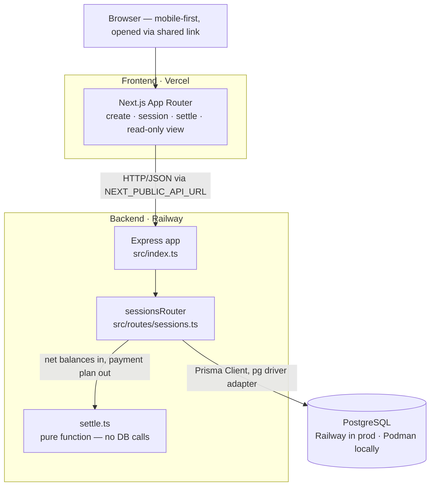
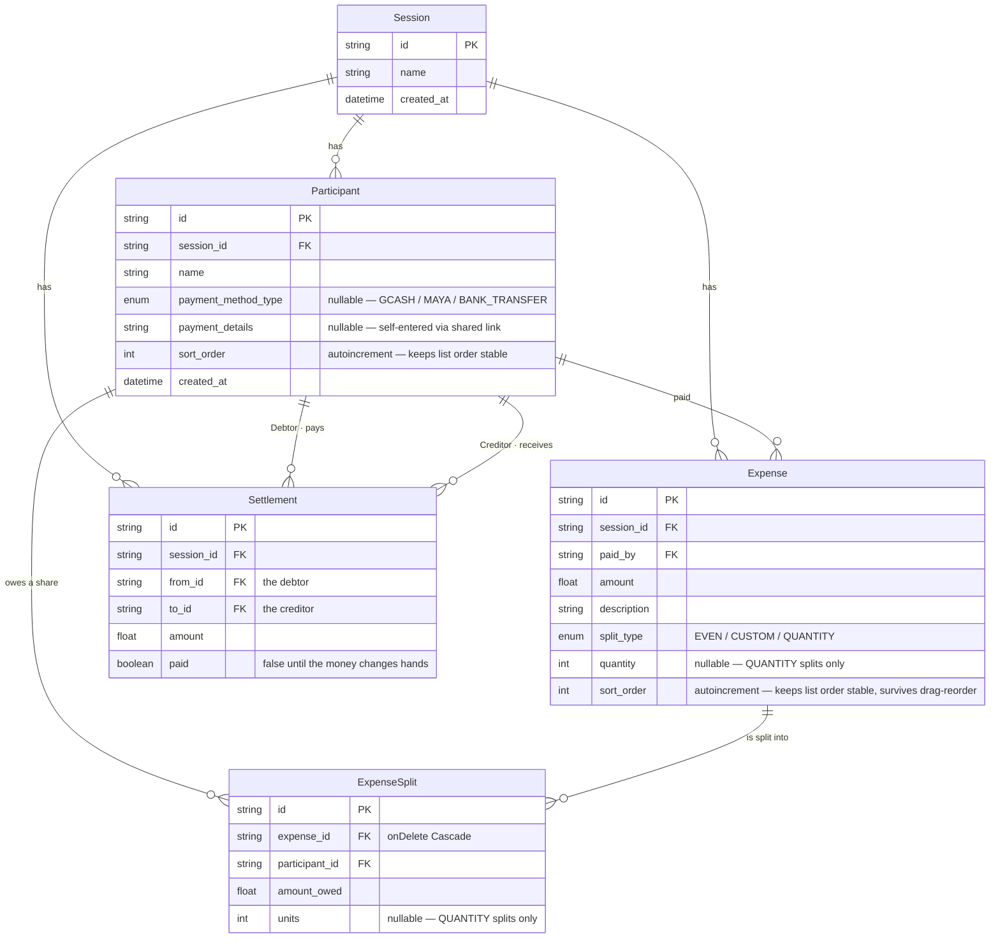
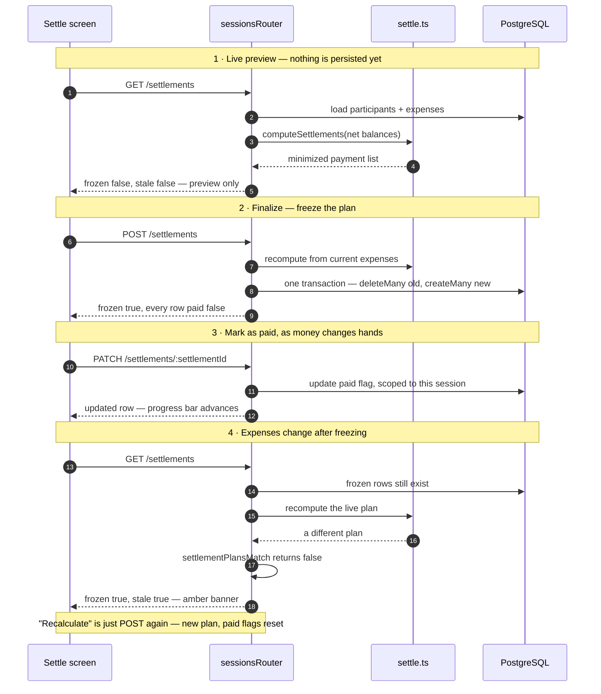

# Divvy — Architecture (current state)

A simple bill-splitting app for friend groups. See [CLAUDE.md](CLAUDE.md) for full product scope. This README documents what's actually built so far and how the pieces fit together.

## Status

| Layer                       | Status                                                  |
| ---------------------------- | --------------------------------------------------------- |
| Local Postgres (Podman)      | ✅ Running via `compose.yml`                              |
| Prisma schema                | ✅ Sessions, participants (+ payment method), expenses, splits, settlements |
| Express API                  | ✅ All V1 routes built — see table below                  |
| Settlement algorithm         | ✅ `backend/src/lib/settle.ts`, greedy debt simplification |
| Frontend (Next.js)           | ✅ All V1 features built — create-session, session view, settle screen, read-only `/view`, design pass. Detail under [Frontend](#frontend-frontend) |
| Backend deployment           | ✅ Deployed on Railway (Express + PostgreSQL); URL lives in the Railway dashboard, not committed here |
| Frontend deployment          | ✅ Deployed on Vercel; URL lives in the Vercel dashboard, not committed here |
| Git / GitHub                 | ✅ Pushed to [github.com/ryansabandal/divvy-app](https://github.com/ryansabandal/divvy-app) (private) |
| Test coverage                | ✅ Vitest — 8 tests on `backend/src/lib/settle.ts`, the app's one piece of pure business logic |

> **Status:** V1 is **feature-complete, deployed, and formally closed** (2026-07-19). A full-repo hardening pass (audit + fixes) preceded closing it — see [Roadmap](#roadmap--next-steps) for exactly what was done.

## High-level flow



## Local dev environment

`compose.yml` defines one service:

- **`db`** — `postgres:16`, exposed on `localhost:5432`, with a named volume (`divvy_db`) so data survives restarts.
- **The only containerized piece** — backend and frontend still run directly on the host via `npm run dev`.
- **Podman, not Docker** — rootless and daemonless, per the engineering principles in CLAUDE.md.

```
podman-compose up -d     # start Postgres
podman-compose down      # stop (keeps data — add -v to wipe the volume)
```

## Backend (`backend/`)

```
backend/
├── prisma/
│   ├── schema.prisma          # data model (Session, Participant, Expense, ExpenseSplit, Settlement)
│   └── migrations/            # generated SQL migrations, applied to the Podman Postgres
├── prisma.config.ts           # tells the Prisma CLI how to connect (migrate, studio, etc.)
├── src/
│   ├── db.ts                  # creates the shared PrismaClient instance for the app
│   ├── index.ts               # Express app entrypoint — mounts sessionsRouter at /api/sessions
│   ├── routes/
│   │   └── sessions.ts        # all /api/sessions/* routes (session-scoped: participants, expenses, settlements)
│   └── lib/
│       ├── settle.ts          # pure function: net balances in, minimized payment list out — no Prisma/DB calls
│       └── settle.test.ts     # Vitest unit tests, incl. regression coverage for the residual-cent fix (see Roadmap)
├── .env                       # DATABASE_URL + PORT for local dev (not committed)
├── tsconfig.json
└── package.json
```

### Why two separate places configure the database connection

Prisma 7 removed the `url` field from `schema.prisma`, so each consumer needs its own wiring — both pointing at the same `DATABASE_URL`:

- **`prisma.config.ts`** — for the Prisma **CLI** (`prisma migrate dev`, `prisma studio`); reads `DATABASE_URL` from `.env` directly.
- **`src/db.ts`** — for the **running app**; wraps a `pg` connection pool in a `PrismaPg` "driver adapter" and hands it to `PrismaClient`. This is Prisma 7's no-Rust-engine mode — queries go straight through the `pg` driver instead of a bundled Rust binary.

### When the dev server seems to be running old code

- **Symptom** — a fix that should obviously work doesn't show up when you test it.
- **Cause** — `npm run dev` uses `ts-node-dev --respawn`, which occasionally misses an edit and keeps serving stale code (and a stale `@prisma/client`, if a migration happened in between).
- **Diagnose** — compare `stat -c '%y %n' <file>` against `ps -o pid,lstart,cmd -p <pid>` for the `ts-node-dev` child process. File mtime newer than process start time confirms it.
- **Fix** — `kill` the process, then `npm run dev` again.

### Data model

Defined in `backend/prisma/schema.prisma`, mirrors the model in CLAUDE.md.



**Two separate `Participant → Settlement` edges** — every settlement row points at two different participants, the debtor (`from_id`) and the creditor (`to_id`). That ambiguity is why the schema names those relations explicitly (`@relation("Debtor", ...)` / `@relation("Creditor", ...)`): with two relations between the same pair of models, Prisma can't infer which foreign key is which.

What each model is for:

- **Session** — a bill-splitting group; has many participants, expenses, settlements.
- **Participant** — a person in a session; can pay expenses, owe splits, and owe/be owed settlements.
  - `payment_method_type` + `payment_details` are **nullable** — self-entered later via the shared link, not at creation time.
  - `sort_order` (autoincrement int) keeps the list order stable. `created_at` can't: Postgres's `now()` returns the *transaction* start time, so participants created together in one nested write all tie — and later `UPDATE`s can reshuffle physical row order.
- **Expense** — one logged cost, paid by one participant, split `EVEN` / `CUSTOM` / `QUANTITY`.
- **ExpenseSplit** — one participant's share of one expense. `onDelete: Cascade` on the `Expense` relation, so deleting an expense removes its splits automatically.
- **Settlement** — a frozen, simplified payment between two participants, with a `paid` boolean.
  - Empty until the plan is finalized — `GET .../settlements` returns a live preview while no rows exist.
  - Once `POST .../settlements` freezes the plan, those rows are the source of truth and `paid` flags persist across visits.

### Request validation (`backend/src/schemas/sessions.ts`)

Request bodies go through **Zod** before any Prisma call:

- **`createSessionSchema`** — `name` (non-empty string) and `participants` (array of non-empty strings, checked element by element).
  - Previously the route only checked the array was non-empty, so `["", null]` reached Prisma.
- **`createExpenseSchema`** — a discriminated union on `split_type` (`EVEN` / `CUSTOM` / `QUANTITY`), each variant with its own required fields.
  - Replaces the old `(s: any)` inline casts, which gave TypeScript no runtime safety.
  - After `safeParse` succeeds, TypeScript narrows the body by `split_type` — no casts in the route body.

DB-level checks (session existence, participant membership, split totals) stay in the route handlers — they need lookups Zod can't do.

### Error handling (`backend/src/index.ts`)

A 4-argument Express error handler, registered after all routes:

- Logs the error server-side, responds with `{"error": "..."}` JSON.
- **Production** — a generic message, no stack-trace leak. **Development** — the real message.
- **Requires `NODE_ENV=production`** in Railway's environment variables to activate the safe behaviour.
- **Without it** — Express 5's `finalhandler` writes the full stack trace into the response body.

### API routes (`backend/src/routes/sessions.ts`)

| Route | Status | Notes |
| --- | --- | --- |
| `POST /api/sessions` | ✅ | Creates a `Session` and all initial `Participant` rows in one Prisma nested write; validated via `createSessionSchema` |
| `GET /api/sessions/:sessionId` | ✅ | Returns the session with `participants` and `expenses` (with `payer` + `splits`) included |
| `POST /api/sessions/:sessionId/participants` | ✅ | Adds one participant to an existing session; 404s if the session doesn't exist |
| `PATCH /api/sessions/:sessionId/participants/:participantId` | ✅ | A participant sets their own `payment_method_type` + `payment_details` |
| `POST /api/sessions/:sessionId/expenses` | ✅ | EVEN / CUSTOM / QUANTITY split; validated via `createExpenseSchema`. EVEN rounding: per-cent rounding is reconciled by pushing the ±1¢ remainder onto the first participant's share, same as QUANTITY — without this, 3-way splits of ₱100 produce ₱99.99 total and settlements never net to zero |
| `PATCH /api/sessions/:sessionId/expenses/:expenseId` | ✅ | Edits an expense in place — same validation as `POST` via `createExpenseSchema` and the shared `buildExpenseSplits()` helper, then replaces the old `ExpenseSplit` rows transactionally (`deleteMany` + nested `create`, same shape the settlement "recalculate" flow already used). Added 2026-07-19 to replace the old delete-and-recreate-to-fix-a-mistake workflow |
| `PATCH /api/sessions/:sessionId/expenses` | ✅ | Bulk reorder: caller sends every expense id in this session in its new order; `sort_order` is reassigned to match. Rejects a partial, duplicate, or foreign-id list — the array must cover every expense in the session exactly once. Deliberately a collection-level route (not nested under `/:expenseId`) so its path can never collide with the edit route above |
| `DELETE /api/sessions/:sessionId/expenses/:expenseId` | ✅ | Removes an expense and its splits (cascade); scoped to the session so you can't delete another session's expense by id |
| `GET /api/sessions/:sessionId/settlements` | ✅ | Returns the frozen plan (with `paid` flags) if one exists, else a live unsaved preview computed via `settle.ts`'s greedy matching; response includes names, not just ids. Also returns a `stale` boolean — for a frozen plan, it recomputes the live plan and flags a mismatch so the UI can warn that expenses changed after finalizing |
| `POST /api/sessions/:sessionId/settlements` | ✅ | Finalizes (freezes) the current preview into persisted `Settlement` rows, each starting `paid: false`. Calling it again — "Recalculate" in the UI — replaces the plan with a fresh one computed from current expenses, resetting any paid progress |
| `PATCH /api/sessions/:sessionId/settlements/:settlementId` | ✅ | Toggles one frozen payment's `paid` flag; 404s if the settlement isn't part of this session |

- **One router file** — everything mounts onto `sessionsRouter` in `sessions.ts`, attached in `index.ts` via `app.use("/api/sessions", sessionsRouter)`. Kept in a single file rather than split per-resource because every route is session-scoped — there's no independent top-level `/api/participants` or `/api/expenses`.
- **Param is `:sessionId`, not `:id`** — stays unambiguous once a route has multiple ids in scope (e.g. `participantId`).
- **Malformed ids 404 cleanly** — a `sessionsRouter.param("sessionId", ...)` gate validates UUID shape before any handler or Prisma call runs. Previously a non-UUID reached Postgres as a raw "invalid input syntax" error and surfaced as a 500.
- **Response serialization (fixed 2026-07-19)** — every route shapes its response through a `serialize*` function (`serializeParticipant`, `serializeExpenseSplit`, `serializeExpense`, plus the pre-existing `serializeSettlement`) instead of returning raw Prisma rows.
  - **Was leaking** — `sort_order`, `created_at`, `session_id`, and the raw `paid_by` id (superseded by the nested `payer` object).
  - Checked against the frontend's own TypeScript interfaces before dropping anything.
- **`buildExpenseSplits()` helper (added 2026-07-19)** — the duplicate-id guards, rounding, and remainder-distribution logic for all three split types was extracted out of `POST .../expenses` into its own function, shared with the new edit route below. Written this way from the start rather than after the fact — copying that ~110-line block a second time into `PATCH .../expenses/:expenseId` would have added a third copy of logic the hardening pass already flagged as duplicated once (backlog ticket 05).

### Settlement algorithm (`backend/src/lib/settle.ts`)

`computeSettlements(balances)` — takes `{ participantId, balance }[]` (positive = owed money, negative = owes money), returns the minimized `{ from_id, to_id, amount }[]`.

- **Method** — greedy debt simplification: sort creditors and debtors by size, repeatedly match the largest of each until both lists are empty.
- **Pure by design** — no Prisma or DB calls. The settlements routes do the I/O (fetch expenses, compute net balances via `computeNetBalances` in `sessions.ts`), then hand the result here.
- **Why that matters** — the algorithm is independently testable; see `settle.test.ts` (8 tests).

**Reconciliation tolerance** — `RECONCILED_EPSILON = 0.005` (half a centavo), exported from `settle.ts`, reused by the CUSTOM-split guard in `sessions.ts`.

- **Was** `0.01` (a full cent), intended to absorb floating-point noise.
- **Bug (found + fixed 2026-07-19)** — a full cent is *also* big enough to misclassify a genuine 1-centavo balance as already settled, silently dropping it from the plan.
- **Failure case from the audit** — someone paid ₱0.02, split ₱0.01 between two others; both were filtered out as "settled" and the payer was never reimbursed.
- **Why half a centavo** — still absorbs real float noise (~1e-13, from repeated arithmetic on already-rounded amounts), too small to ever touch a genuine cent-scale balance.
- Both failure scenarios are now regression tests in `settle.test.ts`.

**CUSTOM-split guard** — tightened the same day, reusing the same constant.

- **Was** — accepted hand-entered splits off by up to a full cent from the expense total, stored as-is.
- **Now** — rejects anything past half a centavo.
- **Why reject rather than absorb** — EVEN/QUANTITY amounts are computed by the *system*, so it owns the rounding. CUSTOM amounts are typed by a *user*, so a real mismatch should come back as an error for them to fix.

### Finalize / recalculate / mark-as-paid



- **Preview** — recomputed on every `GET` from current expenses, never persisted.
- **Finalize** (`POST .../settlements`) — freezes the preview into real `Settlement` rows so individual payments can be checked off (`PATCH`) as people actually pay each other back. This is what makes the progress bar meaningful, rather than just a snapshot of the math.
- **Expenses stay editable** at all times, even after finalizing — there's no lock.
- **Recalculate** — the same `POST` endpoint; replaces the frozen rows with a fresh plan, resetting every payment to unpaid.
- **Stale-plan warning** — a frozen plan can silently drift once expenses change. `GET` recomputes the live plan and compares it to the frozen rows (`settlementPlansMatch` in `sessions.ts`, matching on payer/payee/amount). On mismatch the response sets `stale: true` and both the settle screen and the read-only view show an amber banner — settle prompts "Recalculate", the read-only view says to ask the organiser.
  - Replaces the earlier failure mode: an out-of-date total (e.g. finalized before the last expense was added) displayed with no indication it was stale.

**Rejected design** — a `Session.finalized` flag blocking adds/deletes until "unfinalized". In a no-login shared-link app, a session-wide lock any participant can toggle — which also wipes everyone else's paid progress as a side effect of fixing one missed expense — is worse UX than trusting people to recalculate.

### Inspecting the database directly

- **Prisma Studio** — `cd backend && npx prisma studio` opens a browser GUI at `localhost:5555` showing every table, using the same `DATABASE_URL` as `prisma.config.ts`.
- **Raw SQL** — `podman exec -it divvy-app_db_1 psql -U divvy`, then `\dt` to list tables or `SELECT * FROM "Participant";` to query directly.

### Scripts (`backend/package.json`)

| Script              | Purpose                                      |
| -------------------- | --------------------------------------------- |
| `npm run dev`        | Run the API with hot reload (`ts-node-dev`)   |
| `npm run build`      | Compile TypeScript to `dist/`                 |
| `npm start`          | Run the compiled server (production)          |
| `npm run prisma:migrate` | Create/apply a new migration              |
| `npm run prisma:generate` | Regenerate the Prisma Client after schema changes |
| `npm test`           | Run the Vitest suite once (`settle.ts` coverage)  |
| `npm run test:watch` | Run Vitest in watch mode                     |

## Frontend (`frontend/`)

Scaffolded via `create-next-app` — TypeScript, Tailwind, App Router, no `src/` dir, git init skipped since it lives inside this repo.

- **Deleted** the auto-generated `frontend/CLAUDE.md` — it collided with the root one.
- **Kept `frontend/AGENTS.md`** — it carries a warning worth knowing: Next.js 16.x has breaking changes from older training-data assumptions, e.g. `params` in `page.tsx`/`layout.tsx` is now a `Promise` that must be `await`ed, not a plain object.

```
frontend/
├── app/
│   ├── layout.tsx                        # root layout + sticky navy "Divvy" header (wraps all pages)
│   ├── globals.css                       # Tailwind v4 @theme tokens + hand-written component classes (btn-primary, card, input, etc.)
│   ├── page.tsx                          # create-session form (name + dynamic participant list), POSTs to /api/sessions, redirects to /{sessionId}
│   ├── [sessionId]/page.tsx              # session view — add/delete expenses (3 split modes), inline payment-method entry, share + settle buttons
│   ├── [sessionId]/settle/page.tsx       # settle screen — preview/finalize/recalculate, mark-as-paid, progress bar, copy-to-pay
│   └── [sessionId]/view/page.tsx         # read-only participant view — expense breakdown + settlement plan, no edit controls
├── lib/
│   ├── recentSessions.ts                 # localStorage helper — remembers visited sessions on this device
│   ├── paymentDetails.ts                 # parseBankDetails()/formatBankDetails() — one shared home for the "Bank Name - Account Number" encoding
│   ├── apiUrl.ts                         # apiUrl(path) — builds an absolute backend URL from NEXT_PUBLIC_API_URL
│   ├── fetcher.ts                        # shared SWR fetcher (generic error message parameterized per page)
│   └── expenseBreakdown.ts               # buildParticipantBreakdown() — one person's charges; pure, no React
├── components/
│   └── ExpenseBreakdown.tsx              # collapsible per-person charge list, shared by the settle + view pages
└── .env.local                            # NEXT_PUBLIC_API_URL=http://localhost:4000 (NEXT_PUBLIC_ prefix required for any var read in browser-side code)
```

**Data fetching** — **SWR** (`useSWR`) for client-side GETs, not `useEffect` + `useState`.

- **Why** — satisfies the `react-hooks/set-state-in-effect` lint rule, which discourages fetch-in-effect.
- `mutate()` refetches after mutations; form defaults are derived at render (no `setState` in an effect).
- **Shared helpers (extracted 2026-07-19)** — `lib/fetcher.ts` (takes a per-page fallback error message as a parameter, since page wording differed slightly) and `lib/apiUrl.ts` (`apiUrl(path)`). Replaced three copy-pasted fetchers and ~12 hand-concatenated URLs across all four pages.

**Add-or-edit-expense form** — one form serves both modes; `editingExpenseId` (non-null while editing) picks which. Three split modes, posting to `POST .../expenses` (add) or `PATCH .../expenses/:expenseId` (edit):

- **Evenly** (`EVEN`) — participant checkboxes.
- **Quantity** (`QUANTITY`) — total quantity → per-person units; backend computes the amounts; "units remaining" guard.
- **Amount** (`CUSTOM`) — per-person pesos; "remaining to split" guard.
- Amount/units inputs are `type="text"` (no number spinners) and clamp so totals can't exceed the expense.
- **Edit (added 2026-07-19)** — tapping a card's pencil (`✎`) button pre-fills the form from that expense (description, amount, payer, split type, and the per-participant amounts/units/checkboxes that split type needs) and scrolls it into view. The submit button becomes "Save changes"; a "Cancel" link next to the heading resets back to add-mode without submitting.
- **Reorder (added 2026-07-19)** — each card has a drag handle (`⠿`, `@dnd-kit/core` + `@dnd-kit/sortable`); dragging reassigns `sort_order` for every expense in the session via one `PATCH .../expenses` call. The reorder is optimistic (the new order shows immediately via `mutate({...session, expenses: reordered}, {revalidate: false})`) and rolls back to the server's actual order if the `PATCH` fails.
  - **Why the classic `@dnd-kit` packages, not the newer `@dnd-kit/react`** — the newer package is still pre-1.0 (`0.5.0` at the time), so its API can still break on a minor bump; `@dnd-kit/core`/`@dnd-kit/sortable` (v6/v10) haven't shipped in 19 months, which reads as a settled, mature API rather than neglect.
  - **Why a dedicated drag handle, not the whole card** — the card also has edit and delete buttons; a shared drag surface would make a tap on either ambiguous with the start of a drag.

**CORS** — the frontend (`:3000`) and backend (`:4000`) are different origins, and browsers block cross-origin `fetch()` by default. `cors` middleware in `backend/src/index.ts` uses an explicit origin allow-list (localhost for dev + the Vercel production origin) rather than a wildcard, so only known frontends can call the API.

**Payment-method entry** — inline on the session view; tapping a participant's row in "Who's splitting" expands a small form. `PATCH`es `.../participants/:participantId` on save.

- **GCash / Maya** — a single phone-number input.
- **Bank Transfer** — two inputs (bank name + account number), combined on save into `"Bank Name - Account Number"` and stored in `payment_details`.
- **On the settle screen** — only the account number is copied; the bank name shows as the label (`BPI ·`) for context.
- **No identity gating** — consistent with the rest of the app, anyone with the link can set anyone's payment method.
- **Parsing lives in one place** — `lib/paymentDetails.ts` (`parseBankDetails` / `formatBankDetails`). Until 2026-07-19 it was hand-written with a magic `+3` (the separator's length) in three places independently — exactly the duplication where one drifting copy silently corrupts bank details.

**Payment display** — the settle screen reads each row's creditor payment method via a second `useSWR` call to `GET /api/sessions/:sessionId` (shares the SWR cache, so usually instant).

- All three methods follow one pattern: a label, the copyable detail, and a "Copy" button (Clipboard API).
- **No GCash/Maya deep links** — neither app exposes a public URL that pre-fills a peer transfer, so a "Pay via GCash" button would be misleading.
- **V2 plan** — QR Ph codes, which GCash, Maya, and most banks support natively. See CLAUDE.md's "Out of Scope for V1".

**Per-person charge breakdown** — every settlement row on the settle screen and the read-only view expands (`components/ExpenseBreakdown.tsx`) to show which expenses the **debtor** is being charged for, so a participant can verify their own line items without scrolling the whole expense list.

- **It describes a person, not a payment** — and that distinction is the whole design. The settlement plan is a *simplified routing of net balances*: `computeSettlements()` receives only `{participantId, balance}` and greedily matches the largest creditor to the largest debtor, so it has no idea which expense produced which part of a balance.
- **Why per-payment attribution was rejected** — it isn't well-defined. Worked example: Alice pays ₱300 lunch (split Alice/Bob/Carol), Bob pays ₱150 snacks (split Bob/Dave). The plan is `Carol→Alice ₱100`, `Dave→Alice ₱75`, `Bob→Alice ₱25`. But **Dave and Alice never shared a single expense** — Dave's only charge is Snacks, which *Bob* paid; the algorithm rerouted it. And `Bob→Alice ₱25` has one shared item worth ₱100, because Bob is separately owed ₱75. Listing line items under either row would look like a bug.
- **What it shows instead** — the person's charges, plus (only when they also fronted an expense) the offsetting arithmetic, which is what makes an otherwise-baffling row legible: *Lunch ₱100 + Snacks ₱75 = ₱175 charged, less the ₱150 Bob paid = ₱25 net owed.*
- **Partial-coverage note** — a debtor's net can be split across several creditors. When a row's amount doesn't equal the person's net (compared with a half-centavo epsilon mirroring the backend's `RECONCILED_EPSILON`), the panel says so explicitly rather than letting the totals appear contradictory.
- **No backend change was needed** — both pages already fetch `GET /api/sessions/:sessionId` (the settle page for payment methods), which returns expenses with their splits. The settle page's local `Session` interface just needed widening, typed via the breakdown module's own `BreakdownExpense` shape rather than redeclaring the full `Expense` interface a fourth time.

**Delete expense** — each expense card has a small `✕` button: confirms via `window.confirm`, fires `DELETE .../expenses/:expenseId`, refetches. Errors surface in a red banner above the list.

**Shareable read-only link** — `[sessionId]/view/page.tsx` hits the same two endpoints as the session and settle pages, rendered read-only: expense breakdown, settlement plan with payment-copy buttons, progress bar if the plan is frozen. No forms, no delete buttons, no finalize/recalculate. The session page's "Share view link" button copies `<origin>/<sessionId>/view` to clipboard.

**Design** — Tailwind v4, beige body background, sticky navy header with the "Divvy" wordmark.

- Component classes (`.btn-primary`, `.card`, `.input`) are plain CSS in `globals.css` using `var(--color-*)` custom properties — **not `@apply`**.
- **Why** — Next.js 15 with Turbopack doesn't run PostCSS plugins, so `@apply` is never processed and silently breaks the stylesheet.
- `@theme inline` (Tailwind v4 native) defines the color tokens and generates utility classes; it works under Turbopack because it's part of Tailwind's own CSS engine, not a PostCSS step.

## Version control

- **Single root-level `.gitignore`** — covers `node_modules/`, `dist/`, `.env`/`.env.*`, `.DS_Store`. Repo-wide rather than per-folder, since `backend/` and `frontend/` are both Node/TS and share the same rules.
- **Remote** — [github.com/ryansabandal/divvy-app](https://github.com/ryansabandal/divvy-app) (private).
- **Before resuming** — run `git status` rather than trusting any "uncommitted" notes in this file; they go stale fast.

## Roadmap / next steps

V1 is feature-complete, deployed, and **formally closed** (2026-07-19) — the hardening pass below is done, and there's no single blocking item for next session.

### Hardening (complete — 2026-07-19)

**Method** — a full-repo audit ran *first*, then fixes.

- Three parallel subagents split by *lens* — Correctness, Security, Best-Practice/Smells — each auditing the whole repo independently, consolidated into one severity-ranked report.
- **Why lens-split beats an area split** (frontend/backend): it avoids "seam-blindness", where a bug in the contract between two areas falls in the gap between two reviewers who each only look at one side. See [CLAUDE.md](CLAUDE.md#engineering-principles).
- **Triage** — bugs/correctness in scope for closing V1; smells and nice-to-haves backlogged.
- **Security came back clean on the big risk** — cross-session IDOR is properly defended (every route scopes its lookup by `session_id`), plus no injection, no XSS, no committed secrets, CORS already restricted.
- **One real settlement-math bug surfaced** (#2 below). Per the standing money-as-`Float` decision, it was contained locally with a tolerance fix rather than used as a reason to do the bigger integer-centavos refactor.

Fixed, in order:

1. **Unit tests for `settle.ts`** — added Vitest (`npm test` once, `npm run test:watch` interactive), replacing a placeholder script that just exited 1. 8 tests: empty input, exact single match, everyone-already-settled, greedy-minimizes-transaction-count, plus two regressions encoding #2.
2. **Settlement residual-cent bug** — a `0.01` threshold meant to absorb float noise was also large enough to misclassify a genuine 1-centavo balance as "already settled", silently dropping it from the plan. Fixed with `RECONCILED_EPSILON = 0.005`. Full detail under [Settlement algorithm](#settlement-algorithm-backendsrclibsettlets).
3. **CUSTOM-split guard tightened** — same constant; rejects hand-entered splits off by more than half a centavo instead of silently accepting up to a full cent of drift.
4. **Duplicate participant IDs** — a repeated id in `participant_ids` (EVEN) or `splits` (CUSTOM/QUANTITY) double-charged that person and inflated the even-share denominator while totals still "added up". Now rejected via a `Set` size check in all three split branches.
5. **Malformed session ids returned 500, not 404** — a non-UUID reached Postgres as a raw "invalid input syntax for type uuid" error before the route's own `if (!session)` check could run. Fixed with one `sessionsRouter.param("sessionId", ...)` gate covering every route with that param.
6. **Untrimmed participant name** — `POST .../participants` validated `name.trim()` for emptiness but persisted the untrimmed value, so `"  Bob  "` kept its whitespace. Now stores the trimmed name, matching session creation.
7. **Input size bounds** — Zod schemas had `.min()` on arrays but no `.max()`, so one request (under Express's ~100KB body limit) could nest unbounded participants or splits. Caps added: 50 participants/session, 50 entries per array, 100-char names, 200-char descriptions.
8. **API response leaks** — five routes returned raw Prisma rows, leaking `sort_order`, `created_at`, `session_id`, and the raw `paid_by` id. All now go through `serialize*` functions. Detail under [API routes](#api-routes-backendsrcroutessessionsts).
9. **Frontend duplication** — extracted `lib/fetcher.ts` and `lib/apiUrl.ts`, replacing three copy-pasted fetchers and ~12 hand-concatenated URL call sites.
10. **Bank-details parsing duplicated 3×** — extracted to `lib/paymentDetails.ts`.

**Verified, not just written:** backend `tsc --noEmit` clean · 8/8 Vitest passing · frontend `tsc --noEmit` clean · full `next build` succeeded across all four routes.

**Backlogged from the same audit** — lower-priority, filed as tickets `01`–`12` under `.scratch/v1-hardening-audit/issues/` (see `docs/agents/issue-tracker.md`):

- No rate limiting on any endpoint
- Error disclosure depends on `NODE_ENV` actually being set
- No shared frontend types module — interfaces duplicated byte-for-byte across pages
- Settlement payment-action UI duplicated between the settle and view pages
- Repeated money-rounding logic with no named util
- Inconsistent request validation — Zod in some routes, hand-rolled `typeof` checks in others (notably the two participant routes, untouched by fix #7)
- Near-identical `handleFinalize` / `handleRecalculate` handlers
- CORS origins hardcoded in source instead of an env var
- Non-idiomatic `React.SubmitEvent` type (should be `FormEvent`)
- One stale comment that undersold a 3-way branch as 2-way
- Settlement progress bar with no ARIA semantics
- `noUncheckedIndexedAccess` left off in both tsconfigs

**Filed separately (found later, not from the audit):** ticket `13` — `Settlement`'s relations have no `onDelete: Cascade`, unlike `ExpenseSplit`'s. Deleting a Session today would orphan or fail on `Settlement` rows. Unreachable while no route deletes a Session; surfaced while drawing the README's ER diagram.

**Pre-existing, unrelated to this pass:** `npm audit` flags 3 moderate-severity vulnerabilities in Prisma's own dev tooling (`@hono/node-server`, via `@prisma/dev`). Fixing requires a Prisma downgrade, so it's left alone and noted for awareness.

### Edit & reorder expenses (added 2026-07-19, post-close)

Not part of the hardening pass above — noticed afterward, during regular use, that fixing a mistake on an expense meant deleting and re-adding it from scratch. Unlike the V2 trio below, neither addition needed new infrastructure, so both shipped directly rather than waiting for a V2 milestone.

- **Edit an expense in place** — `PATCH /api/sessions/:sessionId/expenses/:expenseId`, reusing the same validation and split-building logic as `POST` (see `buildExpenseSplits()` above) and the same session-scoped 404 pattern as `DELETE`. Frontend: the existing add-expense form doubles as the edit form, pre-filled from the tapped card.
- **Drag-and-drop reorder** — new `Expense.sort_order` column (autoincrement, same pattern as `Participant.sort_order`) plus a bulk `PATCH /api/sessions/:sessionId/expenses` that reassigns it from a full ordered id list. Frontend: `@dnd-kit/core` + `@dnd-kit/sortable`, chosen over the newer pre-1.0 `@dnd-kit/react` for API stability (see "Add-or-edit-expense form" above).
- **Verified**, not just written: backend `tsc --noEmit` clean, 8/8 Vitest passing, frontend `tsc --noEmit` clean, full `next build` succeeding, plus a live Playwright smoke test against both features in a real browser (pre-fill correctness, no duplicate row after save, reorder surviving a page reload, zero console errors) — screenshots reviewed, not just assertions read.

### Per-person charge breakdown (added 2026-07-19, post-close)

Requested after live use: participants wanted to verify their own charges from the settle screen without scrolling back through every expense. Frontend-only — the data was already being fetched.

- **The literal ask ("line items that make up this payment") turned out to be ill-defined**, and that was worth catching before building: greedy debt simplification routes payments between people who may never have shared an expense. Verified by running the real `computeSettlements()` against a worked scenario — see the "Per-person charge breakdown" bullets under [Frontend](#frontend-frontend) for the example and the full reasoning.
- **Built instead:** a per-*person* breakdown under each settlement row (`components/ExpenseBreakdown.tsx` + `lib/expenseBreakdown.ts`), on both the settle screen and the read-only view.
- **Shared, not duplicated** — one component used by both pages, deliberately avoiding compounding backlog ticket 04 (settle/view payment-action UI already duplicated).
- **Verified**, not just written: `tsc --noEmit` clean, full `next build` clean, plus live Playwright runs against two purpose-built sessions — one exercising the offsetting arithmetic (a debtor who also fronted an expense) and one forcing the partial-coverage note (a debtor split across two creditors). Screenshots reviewed; `aria-expanded`/`aria-controls` wiring confirmed against the live DOM.
- **Drive-by fix:** the read-only view rendered "Annhasn't added a payment method yet" — JSX strips the space after an expression when the text node wraps to another line. Pre-existing (the settle page was unaffected, its equivalent being on a single line), spotted in a verification screenshot, fixed with an explicit `{" "}`.

### V2 (explicitly deferred, not in V1 scope)

All three need file-storage infrastructure this stack doesn't have yet — solve that once for all rather than building upload infra piecemeal:

- **QR Ph code upload** for payment methods — the intended end-state for GCash/Maya/bank payments (payer scans instead of copying a number)
- **Receipt photo OCR** — auto-parse an itemised bill instead of manual entry
- **Proof-of-payment screenshot upload** — let participants validate a payment was made

### Considered but intentionally not scheduled

- **Money as integer centavos** — amounts are stored as `Float`, so rounding logic is scattered. Integer centavos (or `Decimal`) would remove a class of rounding bugs.
  - **Status** — noted, not planned; the current per-cent-remainder reconciliation works.
  - **Re-confirmed 2026-07-19** — the audit *did* find a real rounding bug, and the deliberate call was to contain it with a tolerance fix rather than treat it as the trigger for this larger refactor.
